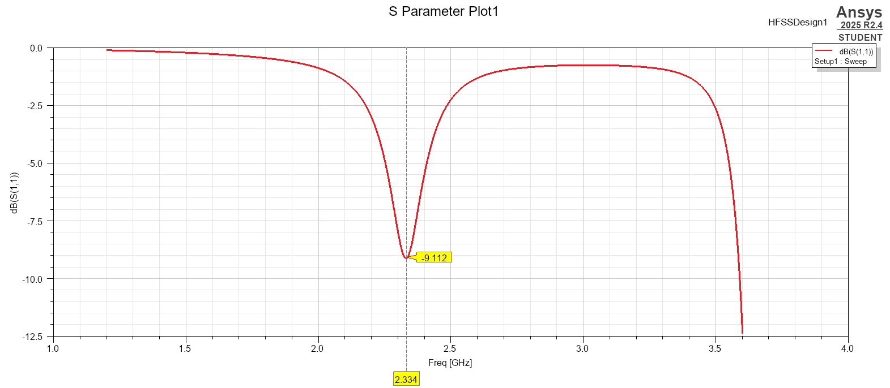
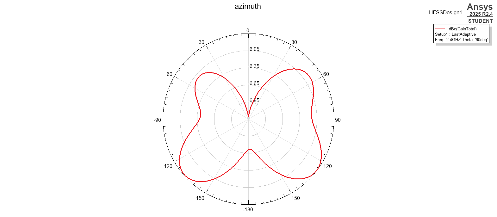
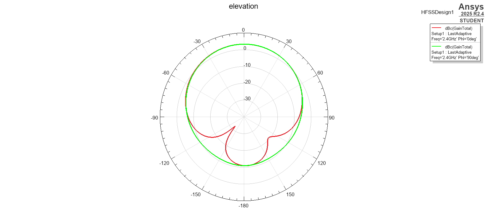
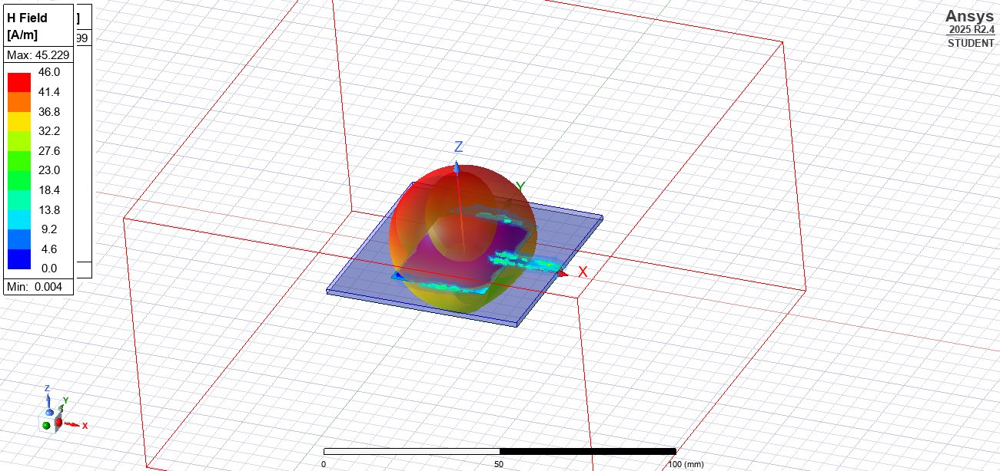
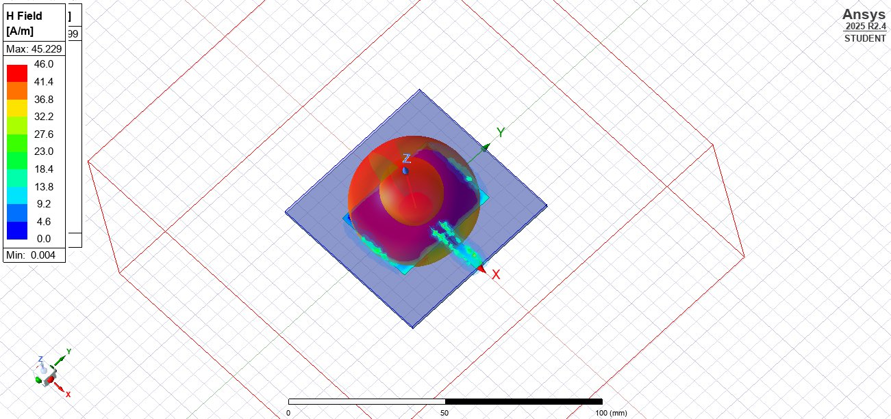

# 📡 2.4 GHz Rectangular Microstrip Patch Antenna

**Design and simulation in Ansys HFSS · FR4 substrate · Microstrip-fed**

Developed during an antenna design workshop conducted by **ARK Infosolutions** at **IIIT Allahabad**.

---

## ✨ Highlights

| Metric | Result |
| --- | --- |
| Target frequency | **2.4 GHz** (ISM band) |
| Simulated resonance | **2.334 GHz** |
| Minimum S11 | **−9.112 dB** |
| Peak gain | **3.31** (HFSS gain legend) |
| Radiation | Directional, broadside |
| Solver | HFSS driven terminal, 1.2–3.6 GHz, 401 points |

---

## 🧱 Design Specifications

| Parameter | Value |
| --- | --- |
| Substrate | FR4 epoxy |
| Relative permittivity (εr) | 4.4 |
| Loss tangent (tan δ) | 0.02 |
| Substrate thickness | 1.6 mm |
| Patch size | 29.4 mm × 38 mm |
| Feed type | Microstrip line with port |
| Feed width | 3.06 mm |
| Design type | HFSS Terminal Network |

The patch sits on top of the substrate, with a ground plane beneath it and a microstrip feed running to the port.

---

## 📐 Theory and Operating Principle

A rectangular microstrip patch antenna is a low-profile radiating element made of a conducting patch placed above a dielectric substrate and backed by a ground plane. The feed couples energy into the patch, and at resonance the patch supports a standing-wave current distribution that radiates efficiently.

The operation rests on electromagnetic resonance:

- The **patch** acts as the resonant radiator.
- The **substrate** sets the electrical size and radiation characteristics.
- The **air above and dielectric below** the patch together determine the effective permittivity.
- The **feed** launches the excitation that establishes the resonant current mode.

### Design Equations

The resonant frequency depends on the effective length and effective dielectric constant of the patch. The classical design equations (Balanis) used to estimate the patch dimensions before simulation are:

**Patch width**

$$W = \frac{c}{2 f_r \sqrt{\dfrac{\varepsilon_r + 1}{2}}}$$

**Effective dielectric constant**

$$\varepsilon_{eff} = \frac{\varepsilon_r + 1}{2} + \frac{\varepsilon_r - 1}{2}\left[1 + \frac{12h}{W}\right]^{-1/2}$$

**Length extension (fringing effect)**

$$\Delta L = 0.412\,h\,\frac{\left(\varepsilon_{eff} + 0.3\right)\left(\dfrac{W}{h} + 0.264\right)}{\left(\varepsilon_{eff} - 0.258\right)\left(\dfrac{W}{h} + 0.8\right)}$$

**Effective length**

$$L_{eff} = \frac{c}{2 f_r \sqrt{\varepsilon_{eff}}}$$

**Physical patch length**

$$L = L_{eff} - 2\,\Delta L$$

where $c$ is the speed of light, $f_r$ is the resonant frequency, $\varepsilon_r$ is the substrate permittivity, and $h$ is the substrate thickness.

> These equations give a starting estimate of the patch size. The simulated geometry in this project is 29.4 mm × 38 mm.

---

## 📊 Results

### Return Loss (S11)


The antenna resonates at **2.334 GHz**, about 66 MHz below the 2.4 GHz target, with a minimum S11 of **−9.112 dB**.

### Radiation Pattern and Gain
| 3D Gain | 3D Gain (alternate view) |
| --- | --- |
|  |  |

Radiation is directional and strongest broadside to the patch, as expected for this antenna type. Maximum gain is **3.31**.

| Azimuth cut | Elevation cut |
| --- | --- |
|  |  |

### Field Behavior
| E-field gain | H-field gain |
| --- | --- |
|  |  |

Animations: [`electric_field.gif`](./lab2.aedtresults/electric_field.gif) · [`magnetic_field.gif`](./lab2.aedtresults/magnetic_field.gif)

Field concentration at the radiating edges and feed region confirms that the patch is operating in its expected resonant mode.

---

## 🔍 Key Takeaways

- ✅ Resonance lands close to the 2.4 GHz target.
- ✅ Directional broadside radiation with moderate gain, typical of a compact patch.
- ⚠️ S11 of −9.112 dB does not reach the common −10 dB matching threshold, so the match is marginal.
- 🔧 **Next step:** fine-tune patch length and feed (e.g., an inset feed) to shift resonance up and deepen the match.

---

## 📁 Repository Structure

```text
MICROSTRIP_patch_antenna/
├── README.md
└── lab2.aedtresults/
    ├── lab2.aedt                 # HFSS project file (source of truth)
    ├── S_Parapatch_1_lab2.png    # S11 plot
    ├── Gain Plot1.png / Gain Plot2.png
    ├── azimuth.png / elevation.png
    ├── GAIN_E-FIELD.jpg / GAIN_H-FIELD.jpg
    ├── electric_field.gif / magnetic_field.gif
    └── lab2.aedtresults/         # Solver, mesh, and result files
```

**To reproduce:** open `lab2.aedt` in Ansys Electronics Desktop (Student edition works) and run the analysis setup.

---

## 📚 References

1. C. A. Balanis, *Antenna Theory: Analysis and Design*, 4th ed., Wiley, 2016.
2. D. M. Pozar, *Microwave Engineering*, 4th ed., Wiley, 2012.
3. R. Garg et al., *Microstrip Antenna Design Handbook*, Artech House, 2001.